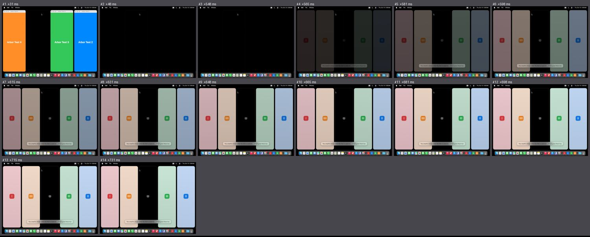
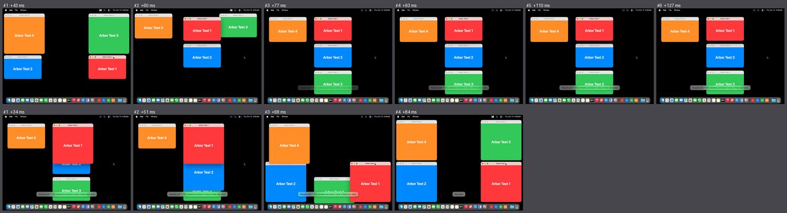
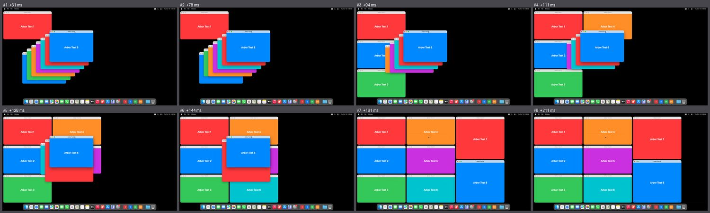
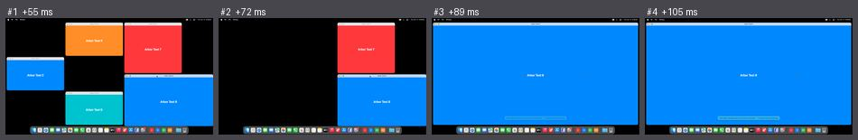
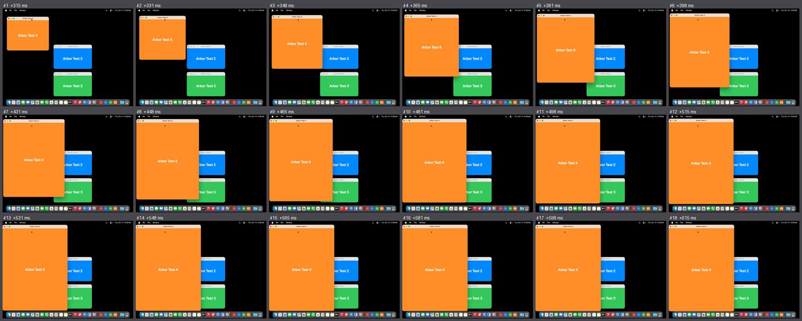

# Polish, the light films, run 1: how "at once" looks, and what macOS's own tiling looks like beside it

- **What was filmed**: `scripts/mac-shell/films-light.sh` as it first was, at trunk `07b2bfc`, Actions run 38684039605, one hosted `macos-26` Mac for both arms, 2026-10-15 05:08 UTC. 1024 × 768 at 1x; eight windows on 1920 × 1080.
  **Reduce Motion off, Reduce Transparency off, macOS's tiling as it comes.** Arbor: `animationDuration` 0, `focusRing` false, `menuBarControls` false, written out; nothing else changed.
  Four (eight) test windows, each (two to) an app of its own. Sixty frames a second, every frame kept; beside the camera a trace per session and the window sampler.
- **Why**: the second build ships without motion. The question was whether "at once" is fit to ship, by two numbers of the product owner's: from the first change of one act to the last, at most 100 ms; frames in which a window is neither where it was nor where it belongs, none. And what the bar looks like: macOS alone.
- **Who judged**: every act looked at frame by frame; then `judge.py acts`, which was written on these films and agrees with the eye in all acts but `close` (where macOS's own fade of the closing window fools it).
- It is not a scored run: it has one of the six metronome films, and its scenes are named `light-…`. The table it led to is in `docs/POLISH.md`.

## Arbor without motion

A piece is a frame in which windows change place or size. Times are ms after the key went down.

| Act | Answers | Pieces | First to last | Frames with a window neither old nor new | What is seen |
|---|---|---|---|---|---|
| dock, the first | +52 | 2 | 17 ms | **1** | the window at its new size in its old place, over the others. The three floating windows are moved aside, unasked  |
| dock, the second | +48 | 2 | 17 ms | **1** | the same |
| dock, the third | +54 | 3 | 33 ms | **2** | new size at the old place; a floating window half covered, then moved and shrunk, unasked |
| dock, the fourth: every window becomes a tile | +31 | | **683 ms** | | **the desk is empty for 500 ms**: every window gone at +48, nothing at all until +548, then four tiles fade in until +731  |
| fill, four windows | +42 | 1 | 0 | 0 | clean: one frame |
| everything, four | +57 | 1 | 0 | 0 | clean. The Desktop column's mark then fades for 84 ms |
| back | +51 | 1 | 0 | 0 | clean. The line "Your other windows are out of view" is still there, fading, 70 ms after it stopped being true |
| float | +39 | 2 | 17 ms | **1** | within its own frames |
| undo | +45 | 2 | 17 ms | **1** | |
| pause | +43 | 3 | 34 ms | **2** | own sizes at docked places first, then the places, window by window  |
| resume | +34 | 4 | 50 ms | **3** | new sizes at old places, windows over one another |
| Arrange Windows, four floating | | 2 | 16 ms | **1** | |
| close a docked window | | 1 | 0 | 0 | the neighbour has grown at once, under macOS's own fade of the closing window (130 ms): fine |
| quit | | 2 | 67 ms | **4** (one state) | own size at the docked place, then home |
| **Arrange Windows, eight floating** | | **7** | **100 ms** | **6** | the windows arrive one by one out of the pile: seven different half-arrangements in a row  |
| fill, eight | +55 | 3 | 34 ms | **2** | the others leave first: holes in the arrangement for two frames, then the window fills  |
| everything, eight | +85 | 2 | 17 ms | 0 | six of eight back, then the rest: a hole for a frame |

**The first number holds** in every act but the one that turns everything into tiles; eight windows are at the mark. **The second fails in 12 of 17 acts.**

## Why, as far as films, trace and sampler say

1. **Size and place are two askings, and the display shows the state between them.** In every dirty act the first bad frame is "new size, old place" (quit and pause: own size, docked place). The sampler has two steps for exactly those windows.
2. **Windows are set one after another**, about a frame (8 to 17 ms) each: four take 2 to 4 frames, eight take 7. These are test windows that obey at once. Real apps will be slower.
3. **The order.** On fill the windows that leave are sent first, so the desk has holes before the one that grows covers them.
4. **The empty desk** is not a wait of the tiles'. By the trace all four windows are out of the way 7 ms after the key's command began and the command is done at +406 ms, with not one call to the window system between: the main thread is making four tiles for the first time, each asking for its app's icon and working its colour out. What gets apps ready ahead of time did so only for motion. (Found in this run's trace by whoever mends it.)

## The bar: macOS's own tiling of the same windows

Arbor not running; Window ▸ Move & Resize ▸ Left, Right, Return to Previous Size, Left & Right; Window ▸ Fill.

| Act | What is seen |
|---|---|
| Left, Right, Fill, Return to Previous Size | **It is not at once. The real window glides and grows, in one piece, eased: 283 to 317 ms, 16 to 18 frames of the 18 to 20 that sixty a second would make.** There are waits of 33 ms: none in one glide, one in two, two in one, and 33, 33 and 50 ms in `macos-right`; the camera's own square has two of 33 ms on this Mac, so some are the runner's. The curve slows down like Arbor's own (0.2, 0, 0, 1) stretched to 290 to 300 ms: off by 1.5% of the road. All four edges in step. No stand-in: the window's own content, laid out afresh in every frame  |
| Left & Right | the window in front glides for 267 ms; the other one jumps to its half in one frame at the start |

Third-party window tools jump. macOS's own tiling does not, and it is the bar. There "the window itself" moves, which is what the first person to use Arbor asked for.

## What came of it

- **A mark for the second build** (the product owner): for the nine keys with four windows, no frame with a hole, none with an empty desk, none in which a window covers what neither its old frame nor its new one covers. That is R5. "None at all" (R4) stays the aim: fill, everything and back show that it can be had. By R5 these films pass in 4 of the 11 acts by key: fill, everything, back, float.
- The cures: a window that shrinks is sized first and then moved, one that grows is moved first and then sized; grow first, then send away; tiles at once; all frames of one act in one breath.
- A probe: whether one window's frame can be set through Accessibility once per display frame for 0.3 s, for the one window the act names, while the others jump as macOS's second window does. These films are its pass mark.
- A first use is told from a standing cost: what stalls is filmed a second time in the same session (`dock-fourth-again`).
