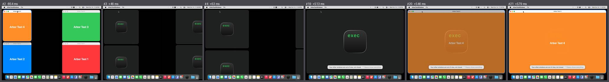
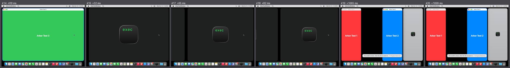
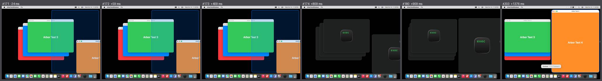
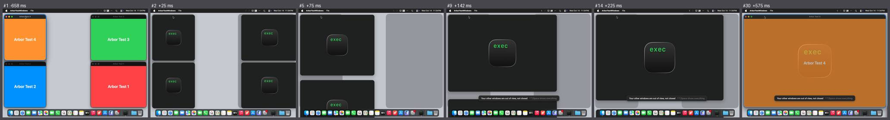
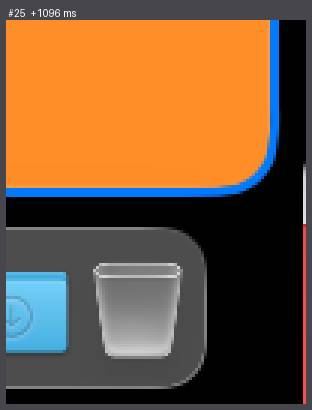
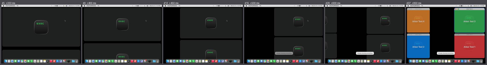
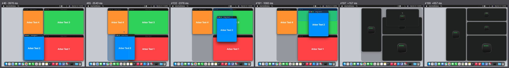
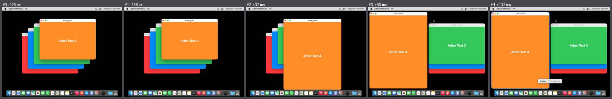

# Polish, run 1: the first time anybody has seen Arbor move

- **What was filmed**: `scripts/mac-shell/films.sh` at trunk `a391fe4`, Actions run 38653628928, a hosted `macos-26` Mac, 2026-10-14 23:27 UTC. 57 films in ten minutes.
- **Who judged**: `scripts/polish/judge.py` (the ruler), then six reviewers with eyes, each with a sixth of the scenes, who also had to confirm or refute
  every miss the ruler claimed. They refuted 51 of them. Every refutation was taken: the cell counts as unseen, and the ruler was mended where it had been fooled.
- **The instruments**: the six metronome films were read as they should be (good: nothing; linear: M3; 900 ms: M2; two pushes: M4; a 9 px hop: M6, measured as 9 px; a flash: M9).
  The camera got every one of the 60 frames a second of its own square, so what is missing from Arbor's films was missing from the display.
- **Score: see the scoreboard in `docs/POLISH.md`.** The verdicts by eye are in `eyes.json`.

## What is right, measured for the first time

| | |
|---|---|
| Length | 447 to 482 ms in the 14 moves by key that could be followed from end to end; the fit with Arbor's own curve is off by 0.2 to 0.9% of the road |
| Easing | they slow down (3.0 to 4.1 where 1.4 is asked), never go past the end, never backwards |
| Answer | first changed frame 20 to 76 ms after the key went down or the button came up, in 32 scenes |
| In step | where several edges could be followed, all within 1% of their roads of one another, with eight windows as with four |
| Hand-over | in the 20 scenes where it could be measured, stand-ins begin and end within 2 px of their windows |
| Left behind | no stage and no preview at the end of any of the 46 scenes that say |
| Reduce Motion | no stage; from the first changed frame to the last at most 100 ms; the same end to the pixel |
| Gaps | 12 px everywhere, by eye and in close-ups (the ruler could not say in this run) |

## Findings

Frames are the film's own numbers; `judge.py sheet <film> out.png --frames a,b,c` shows them. **For** names the work a finding belongs to, not a person.

| # | Severity | What a person sees | Where | For |
|---|---|---|---|---|
| 1 | 1 (M7) | **Every window on the display, also those that do not move, turns into a card within one frame**, and back within two to four, with the card's icon lying over the window's own words. Bright windows blink to dark for half a second. The step is 65 to 88% of full scale where 10% is asked. Before the windows return the cards stand still for 67 to 130 ms.  | every scene with a stage: `frame` 2→3, 19→21 | motion |
| 2 | 1 (M5, M10) | **The display stands still in the middle of a move, for a second, then cuts to the end.** 1000 ms in `desktop-back` (7→8), 983 ms in `tile-back` (18→19), 1066 ms in `dark-dock-drag-beside` while the preview comes (100→101), 183 to 267 ms twice in `rearrange` and `dark-rearrange`. Arbor's log has the stage down long before the display moves again. Whether the display or only the capture stood still is what run 2's second witness is for.  | as named | motion |
| 3 | 2 (M1) | **The first move of a session comes 0.8 s late.** The button comes up, the preview stays, nothing happens for 809 ms (829 in dark). Log: `dropped` at +28 ms, `stage up` at +781 ms. Later drops answer in 41 ms.  | `dock-drag-edge`, `dark-dock-drag-edge` 171→174 | motion |
| 4 | 2 (M5) | **Skipped frames**: three waits of 67 ms in `frame` (7→8, 9→10, 16→17), waits of 33 to 50 ms in the last third of `dock-drag-beside` | as named | motion |
| 5 | 2 (E2) | **The darkened ground behind docked windows does not travel with them**: grey slabs stand where the columns were, or will be, while the cards move over them. Invisible on a black wallpaper, plain on a light one.  | every `dark-…` scene with a stage | motion |
| 6 | 2 (E2) | **A line one pixel wide, white and then in the window's colour, stands at the display's right edge beside the Dock whenever windows are out of view**  | at rest in `frame`, `neighbour`, `peek`, `save-view`, `tile-back`… | windows out of view |
| 7 | 1 (M3, M4) | **One pinch plays as two moves**, first the width, then the height, with a step of 4 to 14 px backwards between them | `pinch-in` 12, `pinch-out` 9, `dark-pinch-in` 9, `dark-pinch-out` 17→18 | zoom |
| 8 | 2 (E4) | **Words that are wrong or too soon**: "Already showing everything" while the view is still zooming out; "Nothing to step into…" over a pinch that worked; "ArborTestWindows and ArborTestWindows" for a saved view; "Your other windows are out of view" still there 340 to 630 ms after ⌃⌥Space has brought them back  | `pinch-out` 15, `pinch-in` 18, `save-view`, `show-everything`, `reduced-show-everything` | the line of words |
| 9 | 3 (E4) | **The line of words lies astride the edge of the window just docked**, and "Too small to show" lies across two other windows, far from the tile it speaks of | `dock-drag-edge`, `dock-key`, `tile`, `rearrange` | the line of words |
| 10 | 2 (E2) | **The drop preview is drawn in front of the window being dragged**: it tints it and strikes through its title  | all four drags onto a target | drags |
| 11 | 2 (D2) | **The preview promises a slot and the window becomes a tile** 171 to 176 px from it | `rearrange`, `dark-rearrange` | drags |
| 12 | 1 (rule 3) | **With Reduce Motion a docked window has its new size at its old place for one frame** (33 ms): two moves for one key. In `reduced-frame` the old focus ring lies across the grown window for a frame; in `reduced-show-everything` the ring is a frame ahead of its window  | `reduced-dock-key` 2, `reduced-frame` 3 | moving real windows; the ring |
| 13 | 3 (E2) | **The focus ring stays behind** as an empty outline for about 100 ms when its window is dragged away | `dock-drag-beside` 33–37, dark 36–41 | the ring |
| 14 | 2 (E1) | **A window dropped with ⌘ held ends up under the docked ones**: it swells for a frame, reappears 34 px off as a card, and the neighbour grows over it | `drag-out` 195–227 | drags |
| 15 | 3 (E3) | **Over a seam the pointer stays an arrow**; the two windows of a column are 3 to 4 px out of step in one frame of four while the seam is dragged | `seam` | seams |
| 16 | 3 (E2) | **A floated window ends against the display's edge and the Dock**, its ring cut off, with a bit of the Desktop's mark sticking out above it | `float` 29–34 | floating |
| 17 | 2 (P1) | The shortcuts come 140 ms after the key | `panel-shortcuts` 1 | panels |
| 18 | not counted | With pictures of windows: words and traffic lights are stretched, and for four frames title and words show twice | `pictures-frame` 6–9, `pictures-dock-key` 3–8 | motion |

## What the run taught about filming

- ScreenCaptureKit's stream works unattended on a hosted Mac with the Screen Recording that child processes have there, at a steady 60 frames a second, and a listen-only event tap gets the keys.
  `screencapture -v -V 3` also exits with 0, and leaves 16 KB of a screen on which nothing moved.
- Core Animation starts its clock when the animation is handed over, and the first frame shows two to three frames later: the metronome's first visible frame is already 18% along the road. Arbor's are too. A curve that
  covers half the road in its first fifth loses most of its soft start that way.
- Two panels (Go to…, the minimap) keep out of screen captures by design, so they were not in the films: `ARBOR_PANELS_IN_PICTURES=1` from run 2 on.
- Arbor swallows a ⌃⌥ drag before a tap in the session sees it: the camera's tap sits where the mouse comes in from run 2 on.
- The tool that presses a key takes half a second to start, so "a fifth of a second later" was 796 ms. Started side by side from run 2 on.
- All test windows are one app's, so all cards look alike, which costs the ruler its bearings wherever they overlap and costs E1 more than a person's own apps would. A cast of several apps is the next step.
- The wall clock and the clock frames are stamped with parted by 0.1 s in four minutes. Tied together film by film from run 2 on.
- 155 MB of films went through a branch. A third of that from run 2 on, and the branch is overwritten as soon as it has been fetched.
