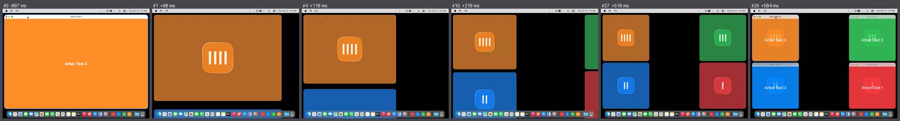
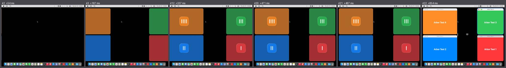
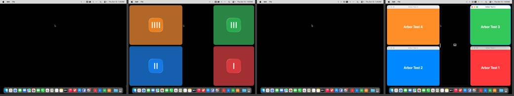
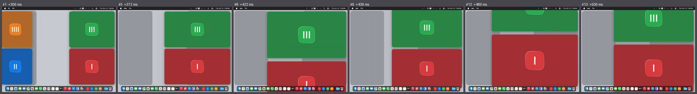
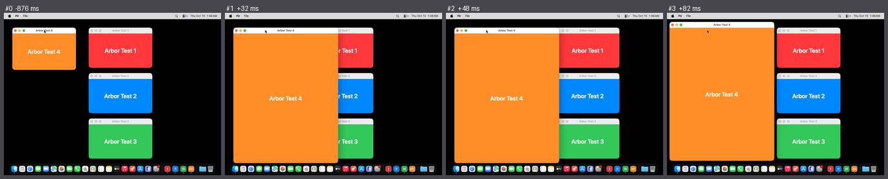

# Polish, run 2: a cast, panels in the picture, a second witness

- **What was filmed**: `scripts/mac-shell/films.sh` on trunk `302a0b0`, Actions run 38666518782, a hosted `macos-26` Mac, 2026-10-15 01:38 UTC. 57 films, 84 MB (run 1: 155).
- **New in the laboratory**: each test window is an app of its own, so cards have colours and icons; Go to… and the minimap let the camera see them; the camera's tap sits ahead of Arbor's, so a ⌃⌥ drag has its button times;
  windows that do not overlap for docking by key, floating and undo; two keys really a fifth of a second apart.
- **Who judged**: the ruler, then six reviewers with eyes. They refuted 44 of its misses (taken; the ruler is mended for shadows that the window in front throws on its neighbours, for the focus ring in a gap, for two keys in one scene) and found two films void.
- **The instruments**: five of the six metronome films as they should be. In the sixth the spark stayed 183 ms, because the timer that puts it out came late on a busy Mac: too long for a flash, and the ruler measured it as 183 ms, frames 22 to 27, as the frames show. From run 3 on it is timed by Core Animation.
- **Score: 42.8** (run 1, under the ruler as it is now: 36.6), 56% seen. Verdicts by eye: `eyes-run-2.json`.

## What moved the number

| | |
|---|---|
| Up, the laboratory's doing | with a cast, "one can tell which window goes where" (E1) passes in 35 of 50 scenes (29), "no frame is ugly" (E2) in 19 (9), "could be macOS's own" (E3) in 13 (8); docking by key, floating, undo, closing and three panels can be measured |
| Up, measured right | `dock-key` 459 ms, `float`, `undo`, `close`, and `twice-quickly`: the second key carries on from where things are, 450 ms, no step back, at rest 628 ms after it |
| Void | `dock-drag-beside` (the script's own fault: apps that start side by side pile their windows up as it comes, and the press took another window) and `rearrange` in light mode (no preview in any frame, the window cut back to its slot; script or Arbor cannot be told from the film). Mended for run 3 |

## Findings that are new, or clearer than in run 1

| # | Severity | What a person sees | Where | For |
|---|---|---|---|---|
| 1 | 1 (M5, M10) | **The cards wait for their windows.** They arrive, stand still for 367 ms, then cut to the windows without a fade; in `tile-back` the picture stands still for 974 ms half-way. The log has the stage down at +696 ms, the windows show at +854 ms. **The second witness** (macOS's own screenshots, taken beside the film) caught the moment between: no stage, and no windows either. So the stage is taken down before the real windows are back from out of view; the display, which the stream follows, shows the last picture it composed until they are.   | `desktop-back` 21→22, `tile-back` 13→14, `dark-rearrange` 90→91 | motion; windows out of view |
| 2 | 2 (M1) | **The first move of a session is later with more apps**: 1091 ms with four apps (809 with one). The cause is known and mended elsewhere (icons were asked for on the way up): to be seen in run 3 | `dock-drag-edge` 49, dark 56 | motion |
| 3 | 1 (M3, M4) | **A pinch aims three times**: at the column, at the window, at its neighbour, and back, with steps of 4 to 81 px backwards  | `dark-pinch-in` 5, 9, 13; `pinch-in` 6; `pinch-out` 5 | zoom |
| 4 | 1 (R3) | **Without motion a dock comes in three jerks**: the window grows where it is, the others jump, then it jumps. Quitting shows a window in three places too  | `reduced-dock-key` 1 to 3, `quit` | moving real windows |
| 5 | 2 (D3) | **The preview comes softly (70 to 100 ms) and leaves in one frame**; so does the rectangle | all drags onto a target, `rectangle` | drags |
| 6 | 2 (P1) | **Go to… comes 254 ms after the key, one millisecond after ⌃⌥ are let go**: it seems to wait for them. The menu comes 344 ms after the press and is taller than the display; the shortcuts come after 147 ms, with a fade, and go with a cut | `panel-go-to` 1, `panel-menu` 12, `panel-shortcuts` 1 | panels |
| 7 | 2 (E1, E4) | **A view of the empty middle is wholly black**: no outline, no mark, no words, with every window out of view | `neighbour` from 21, `peek` from 51 | the camera |
| 8 | 3 | **The cards stall for a frame when the line of words begins to fade in** | `dark-frame` 3 and 4, `tile-open` 18 and 19 | motion; the line of words |
| 9 | 1 (D4) | **Beside a dragged seam the two windows of a column do not step together**: one is 3 px ahead in 23 frames | `seam` | seams |
| 10 | 3 | A tile shows nothing under the pointer or when pressed | `tile-open` | tiles |

Still there as in run 1: the cut to cards and back (now a third darker rather than near black, the icon's bars showing through the window's words at the hand-over); the grey ground that does not travel; the line one pixel wide at the right edge, which alone costs E2 in four scenes;
words too soon ("Already showing everything", "Nothing to step into"); the preview in front of the dragged window; the ring left behind.

## What the run taught about filming

- Two witnesses can both be right. A stream of the display shows what was composed; a screenshot composes the windows as they are listed at that moment, shown or not.
- A timer in the camera's own process is no metronome on a busy Mac.
- ⌘-drag moves a window of another app without raising it, so the pile has to be put in order first.
- The window in front throws a shadow 16 px wide on its neighbours: their colour there is the same hue with less light, which is how the ruler now knows it.
- Changes of up to 2 in 255 that the camera leaves out can add up to a faint trail behind an icon in the film. Nobody would see it, and it is the camera's.
