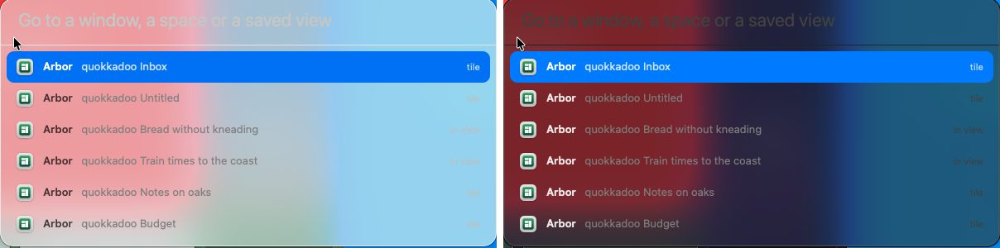
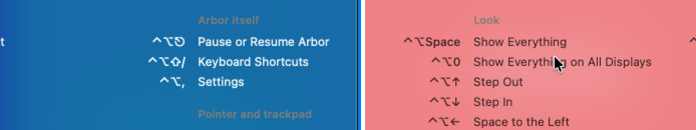
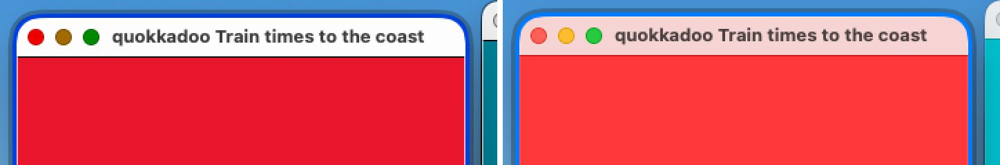
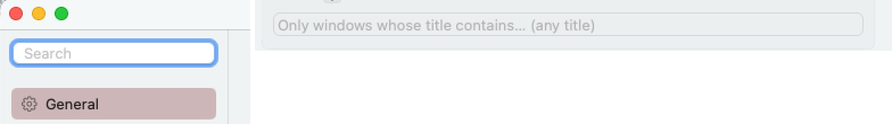
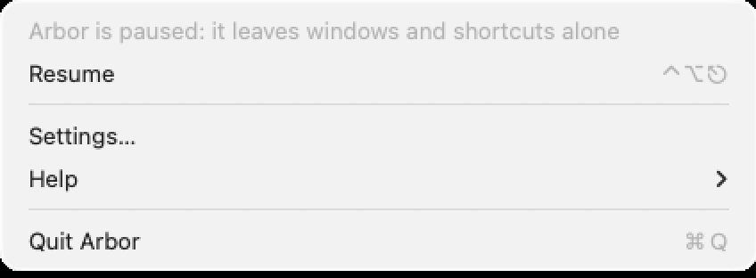
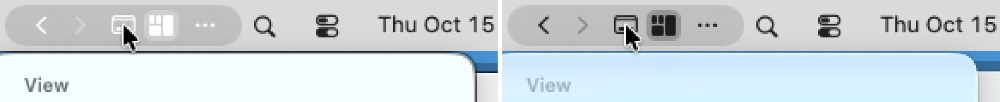

# Polish, the pictures at rest: S1 to S7 measured for the first time

- **What was measured**: the gallery's 184 pictures of the real app on hosted Macs (branch `gallery/pictures` `ee9c11c`, `collab/evidence/gallery`): most from Actions run 38669956766, the trunk at `5f18637` with
  three pull requests, of which one, on tiles, has not landed; older ones where the gallery's page says so. **The tile is left out of the count**: it was pictured only on that branch.
- **Who judged**: five reviewers with eyes who have built none of it, each with a share of the panels. They looked, named the rectangles, and `scripts/polish/stills.py` measured inside them
  (`scripts/polish/REVIEWERS-STILLS.md`). Every verdict names its picture, its rectangle and its numbers: `stills-1.json`.
- **The ruler was itself reviewed, and measured three times.** The reviewers found it fooled three ways in the first round. Then an adversarial review of the ruler found that it could not miss where it mattered: text at the sides of a short
  panel, a ground that lets much through, an "outline" that was the panel's own ground; and that fourteen of twenty-one planted faults got past its self-test. It was rewritten; its second way of reading contrast turned out 7 to 19% low
  on words drawn in known colours, and was replaced. As it stands: 30 drawn pictures, 27 of 27 planted faults caught, contrast 2% low in the middle and at most 4% low in 19 lines of 20 (a reading up to 4% under a mark reaches it). Every number below is of the third round, at the same rectangles.
- **Seen**: 56 of the 125 cells. 38 pass, 18 miss. Nothing is known of the tile as it ships, the coach, the setup check and the tab strip; nearly nothing with Reduce Transparency, and only two panels at two pixels to the point.
- **Score: see the scoreboard in `docs/POLISH.md`.**

## What is right

| | |
|---|---|
| Crisp (S1) | every straight side of every panel that could be asked takes 0 pixels between, at 1x; the heads-up line and the focus ring also at 2x |
| On the pixel (S2) | no side of any of the 13 panels has a row half-way |
| Text fits (S3) | nothing clipped, truncated or touching in the heads-up line (18 to 20 pt at the sides), the name field, Go to…, the shortcuts (27, 24, 28, 22 pt), any of the settings window's panes in any look |
| What one reads first | app names in Go to… 5.7 to 8.1 : 1 at worst on glass; rows and keys of the shortcuts 4.5 and better; the menu's items 7.2 to 10.7 at worst; row titles in the settings over 10; the heads-up line in the dark look 6.0; the name field in the light look 4.65 |
| Increase Contrast (S6) | honoured by the heads-up line (the line at its side 4.0, ink 15), the shortcuts (4.2, 7.8), the minimap (4.3 to 5.1) |
| Reduce Transparency (S7) | the shortcuts' ground: 0.0 levels in eight boxes without words, all one colour |

## Findings

**For** names the work a finding belongs to, not a person. Several are in the gallery's own list already; here they have numbers and a cell.

| # | Severity | What a person sees | Where | For |
|---|---|---|---|---|
| 1 | 2 (S4 on glass, light and dark; S6) | **In Go to… everything but the app's name is a fixed grey that does not know what lies behind it.** The field's words 1.02 to 1.25 : 1; the titles, which are what tells six windows of one app apart, 1.84 to 2.3 at worst; the notes 1.1 to 1.35; "Nothing matches" 1.9 to 2.2. In the dark look the greys are darker than the ground over red and lighter over the sky, so a line fades out and comes back. Even on the bare material the titles are 2.95 and 1.46. With Increase Contrast four kinds of words stay under 7 (3.8 to 5.3).  | `go-to-light`, `go-to-dark`, `go-to-none-…`, `go-to-contrast` | panels |
| 2 | 2 (S4 on glass) | **The shortcuts' headings and last line are the same fixed grey**: "Pointer and trackpad" 1.26 : 1 over blue in the dark look, "Look" 1.54 over red in the light one, "Press any key to close" 1.54. Flat they are 2.99 to 3.08, which passes only because they are secondary, and the lowest only by the ruler's error.  | `sheet-dark`, `sheet-light`, `opaque-light` | panels |
| 3 | 2 (S6) | **Arbor's lines do not answer Increase Contrast.** The accent gets darker, on a dark surface, and no wider: the focus ring 1.1 to 1.7 : 1 to the surface it lies on, the peek's outline 1.05 to 2.3 on three sides, the preview's border 2.0 to 2.3 above and below, where 3 is asked. The seam's handle is pixel for pixel what it is without the setting (2.55).  | `ring-contrast`, `peek-contrast`, `preview-contrast`, `gap-hover-contrast` | the ring; drags; seams |
| 4 | 2 (S4) | **Placeholders that are a field's only label** (macOS's colour; the choice is Arbor's). The settings' search field is a plain text field without the magnifier: "Search" 1.80 : 1 (3.85 with Increase Contrast). Rules: "Only windows whose title contains… (any title)" 1.80 light, 2.20 dark, 4.72 with Increase Contrast. The cure is a label or an icon that says it, not a brighter placeholder, which would look typed; for the search, macOS's own search field.  | `settings-on-screen-light`, `settings-rules-…` | the settings window |
| 5 | 2 (S4) | **The two lines of the menu that say what is the matter are greyed items**: "Arbor is paused: it leaves windows and shortcuts alone" and "Arbor needs Accessibility permission", 1.86 : 1. The grey is macOS's for an item that cannot be chosen; to say the one thing a person must read in it is Arbor's. The product owner: the worst of these, and the cure is not a colour: make each an item that does something (Resume Arbor; Open Accessibility Settings…), enabled, so that the sentence is also the way out.  | `menu-paused-light`, `menu-no-permission-light` | the menu |
| 6 | 2 (S6) | **With Increase Contrast and the menu open, Arbor's glyphs in the menu bar turn white on light grey**: the tiles on their plate 1.56 : 1, back between 1.7 and 1.8, forward not measurable. Without the setting the same glyphs are 5.7 to 8.7.  | `menu-contrast` against `menu-light` | the menu |
| 7 | 2 (S4) | **Warnings and refusals in the settings**: orange 2.03 : 1 in the light look, with two buttons that depend on reading it; red 3.1 light, 3.9 dark; the dark banner's two buttons 4.02. (Pictures of an earlier build: to be taken again.) | `settings-clash-light`, `settings-caution-light`, `settings-refused-…`, `settings-broken-dark` | the settings window |
| 8 | 1 (S3) | **On a display 768 points high the menu does not fit** (it is about 840 points, not 705: the picture that was measured for that is a shrunk one). macOS scrolls it, the ways out are below the fold, and with Increase Contrast the last heading is cut to three rows of pixels | `menu-contrast`, `menu-light`, `menu-whole-light` | the menu |
| 9 | 2 (S4 on glass) | **The heading of the name field, which is its label, 3.75 : 1 in the dark look over red** (4.65 in the light one, which passes). Nothing is drawn round the field, and in the empty pictures there is no caret: with the placeholder at 2 : 1 nothing says that one can type | `name-dark`, `name-typed-dark`, `name-light` | panels |
| 10 | 2 (S4 on glass) | **The heads-up line in the light look misses by a hair**: 4.30 and 4.31 : 1 where the dark wallpaper comes through as a middle green, and 4.32 would have reached the mark; 5.0 over red | `line-sentence-light`, `line-problem-light` | the line of words |
| 11 | no cell | **In the dark look over red the minimap's plates merge with its ground** (1.11 to 1.16 : 1; three of eleven real apps' plates 1.07 to 1.10). With Increase Contrast plates out of view are 1.9, and the line round the view is 1.05 to the plate it surrounds. The line fills the gap under the view and touches the two plates below | `minimap-dark`, `apps-minimap-dark`, `minimap-contrast` | panels |
| 12 | no cell | **The rectangle of a ⌃⌥ drag on a blue window: 1.13 : 1**, found only by enlarging; the seam's handle while dragged 1.09. (Older pictures: to be taken again.) | `band-light`, `gap-dragged-light` | drags; seams |
| 13 | no cell | The heads-up line's top edge sits on the feet of a tile's label, and its right end covers 22 of the 40 px of a tile's icon; the dot between sentence and hint is 1.34 : 1; ⎋ at 1x reads as a clock | `line-sentence-…`, `line-hint-…`, `bar-paused-…` | the line of words |
| 14 | no cell | The same commands stand under different headings in the shortcuts (Look, Arrange, Arbor itself) and in the menu (View, Focused Window, Arrangement, Arbor); ↑ ↓ are arrows in one and solid triangles in the other | `sheet-light`, `menu-whole-light` | words |
| 15 | no cell | In the settings: "Pause for" stands 123 px to the right of every other row; rows behind Advanced stand 12 to 14 px apart against 25 to 27 above; the Shortcuts pane's list runs under the window's round lower edge | `settings-apps-advanced-…`, `settings-…-advanced-…`, `settings-shortcuts-…` | the settings window |

The other remarks, over fifty, are in `stills-1.json` under `other`.

## Two rulings of the product owner's, applied here

Where macOS draws its own control in its own colour, macOS is the measure (`docs/POLISH.md`, under S8). So a standard menu's headings, key equivalents and greyed items (1.7 to 2.2 : 1 on glass) and greyed buttons
cost nothing, and the menu passes S4 on glass by its items. A placeholder is exempt only where something else says what the field is for: the name field's is (it has a heading), the settings' two and Go to…'s are not. The chosen row of Go to… is Arbor's own fill:
white on the accent colour is macOS's pairing and costs nothing, the fainter title and note on it are Arbor's and count.

## What the pictures owe

- **Three of the five pictures "at 2x" are not**: `go-to-2x-light`, `sheet-2x-light`, `tiles-2x-light` were taken at 2880 × 1800 and are stored at 1600 × 1000, 1.11 pixels to the point, resampled. The five pictures of the whole menu
  are shrunk to 0.84. No edge in them can be asked anything. A picture to be measured is cropped, never scaled.
- With Reduce Transparency there is one picture, of the shortcuts: `S4 light`, `S4 dark` and `S7` are unseen for nearly everything else.
- macOS's alert about "Python" lies over the middle of a third of the pictures with Increase Contrast, and has the keyboard in them: the name field's S6 was left out for it.
- No long title in Go to…, no long name in the name field: the hardest case of the check S3 is in no picture.
- The warnings, refusals and the banner of the settings, the rectangle and the dragged handle are from earlier builds, and none of them exists with Increase Contrast.
