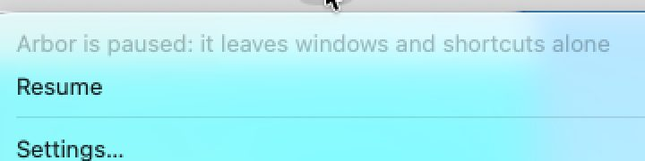
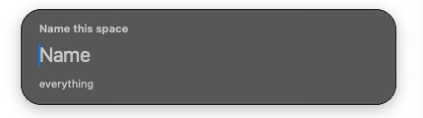
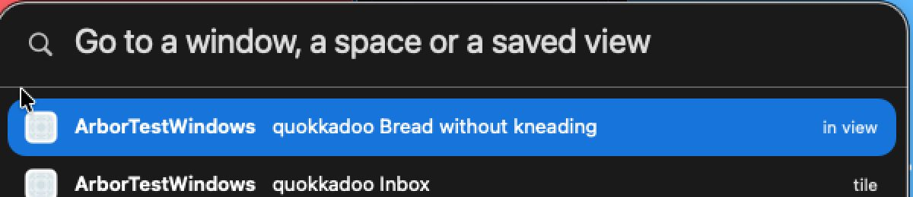
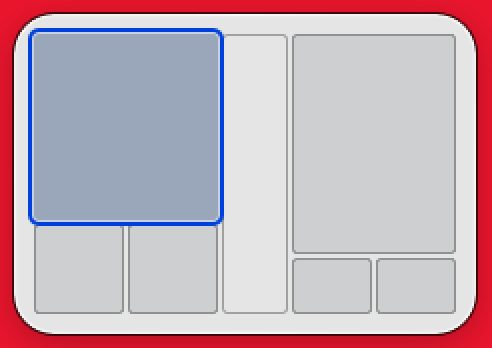
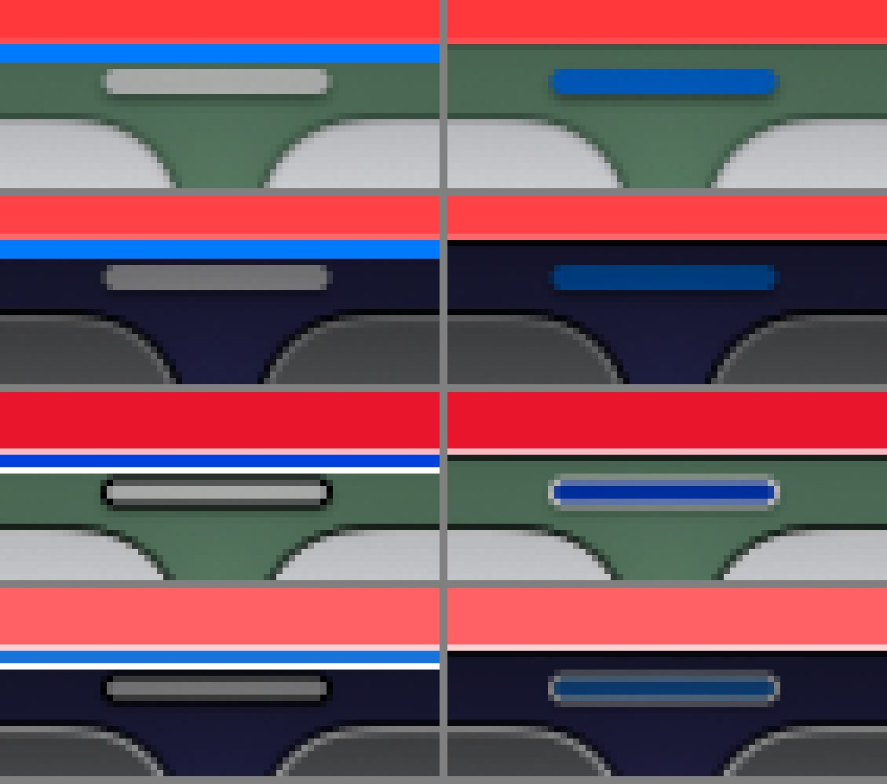
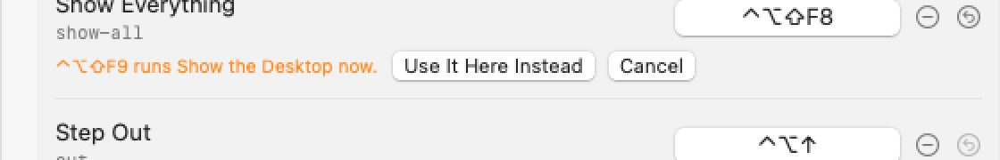

# Polish, the pictures at rest, second round: what the change to the panels did

- **What was measured**: the gallery's second run on a hosted Mac (Actions run 38685258262: the trunk at `07b2bfc` with three pull requests; the one on panels is on the trunk since, as `f39029b` and `356f437`), its raw pictures, never scaled: every panel that
  holds words over four plain wallpapers, the worst there is behind a panel (a saturated red, a saturated blue, white, black), on glass and with Reduce Transparency, light and dark; crops at a true two pixels to the point; whole tours with Increase Contrast and with Reduce Transparency; a title of
  115 letters, a name of 75. And 95 newer pictures of the settings window, from the branch whose one commit on the window's code, `f42e3a0`, is on the trunk (the commit that was pictured can no longer be fetched; whoever took the pictures held it against the trunk: every file of the window's is the same, byte for byte).
- **Who judged**: five reviewers with eyes who have built none of it and had not seen the first round, each with a share of the panels (`scripts/polish/REVIEWERS-STILLS.md`). They were told what the builder claims and told not to take it over. Every verdict names its picture, its rectangle and its numbers: `stills-2.json`.
- **Two counts agree.** Where the builder had measured with the same ruler, the reviewers drew their own rectangles and came within the ruler's 4% everywhere: Go to…'s field 5.00 to 7.69 (claimed 5.1 to 7.8), its titles from 7.23 (7.3), notes from 4.96 (4.9); the shortcuts' headings 4.10 to 7.83 (4.1 to 7.9), rows from 5.69 (5.8); the line 5.73 to 13.44 (5.8 to 12.8); the name field from 4.09 (4.1).
- **Seen**: 72 of the 125 cells, 60 pass, 12 miss (first round: 56, 38, 18). **Counted**: 64, 57 pass, 7 miss, since the menu is left out, see below.

| | cells | seen | pass | miss | points |
|---|---|---|---|---|---|
| What ships, first round, as it was counted then: with the menu | 74 | 30 | 18 | 12 | 50 of 206 |
| What ships, first round, without the menu: like for like with the next row | 74 | 23 | 14 | 9 | 40 of 206 |
| **What ships, second round**, without the menu | 74 | 30 | **26** | **4** | **70 of 206** |
| (What ships, second round, had the menu been counted) | 74 | 38 | 29 | 9 | 75 of 206 |
| The options, first round | 51 | 26 | 20 | 6 | 48 of 135 |
| **The options, second round** | 51 | 34 | **31** | **3** | **79 of 135** |

**Like for like, what ships went from 40 points to 70, not from 50.** And of the nine misses that became four, **three are cured** (Go to… on glass in both looks, the heads-up line on glass in the light look) and **two are no longer pictured**: the settings window on glass in the light look (S4) and with Increase Contrast (S6) missed in the first round and are in no picture of the second. They are unseen now, which counts like a miss; nobody has mended them that these pictures know of.

More than half of what ships is still unseen: the tile, the coach and the setup check have never been pictured as they ship, and the menu has changed since it was.

## Left out of the count, and why

- **The menu.** What makes it has changed since it was pictured (its height, its rows). The pictures show a menu of 846 points that does not fit a display of 768, with seven of 29 items out of sight; a change that holds it to 600 points has landed since. Its eight cells (three pass, five miss) are in `stills-2.json` and count for nothing until it is pictured again. One finding is passed on all the same, see 1 below.
- **The tile**: what draws it in these pictures has not landed. **The rectangle**: it was not up when its picture was taken.
- Go to… has learned to find commands since. What draws it is unchanged, so it is counted; rows of the new kinds, greyed ones among them, are in no picture.

## What is cured

| First round | Now |
|---|---|
| In Go to… everything but the app's name was a fixed grey: the field 1.0 to 1.3 : 1, titles about 2 | field from 5.00, titles from 7.23, notes from 4.96, over all four wallpapers in both looks; nine cells of ten pass. A magnifying glass says what the field is for |
| The shortcuts' headings and last line 1.3 to 2.1 | from 4.08: all ten cells pass |
| The heads-up line in the light look missed by a hair, 4.30 | from 7.84 in the light look, 5.73 in the dark one: all ten cells pass |
| The name field's heading 3.75 in the dark look over red | 6.03 there (but see 2) |
| The focus ring did not answer Increase Contrast, 1.1 to 1.7 | a point of white outside two of blue: 3.80 at the worst spot in the light look, from 10.1 in the dark one |
| The minimap's plates merged with its ground in the dark look over red, 1.1 | fill 2.32, line 4.25 (but see 4) |
| In the settings "Pause for" stood 123 px to the right of every other row; rows behind Advanced stood half as far apart as those above | gone; 2 px tighter |
| With Reduce Transparency one picture | Go to…, the line, the name field, the shortcuts, the minimap: 0.0 levels within a box and between wallpapers |

## Findings

**For** names the work a finding belongs to, not a person.

| # | Severity | What a person sees | Where | For |
|---|---|---|---|---|
| 1 | 2 (S4, S6; not counted) | **"Arbor is paused: it leaves windows and shortcuts alone" is still a greyed item**: 1.81 : 1 in the light look on glass, 2.00 in the dark one, 1.83 with Reduce Transparency; 4.60 and 5.14 with Increase Contrast, where 7 is asked. It is the only line that says what is the matter. The drawing is macOS's, putting these words into a greyed item is Arbor's; on the trunk it is a text item still.  | `light-22b-paused-menu` 609,40,334,16 | the menu |
| 2 | 2 (S4 dark on glass) | **The name field in the dark look over white: its three fainter kinds of words share one ink, 4.09 to 4.11 : 1** (at most 4.28; the mark less the ruler's error is 4.32; by whole pixels 196 on 87, 4.14). The heading alone says what the field is for; the note alone says which space gets the name.  | `dark-on-white-5-name` 338,192,94,17 | the panels |
| 3 | 2 (S6) | **In Go to… the note on the selected row does not answer Increase Contrast**: 3.75 : 1 in the dark look, 5.79 in the light one; 7 is asked. It is the selection's ink thinned to 0.85, Arbor's choice; full white reads 7.5 in the light look. It is also the faintest of all the panel's words without Increase Contrast (4.73, 4.87).  | `dark-contrast-08-go-to` 753,277,41,14 | the panels |
| 4 | 2 (S6) | **The minimap's plates do not answer Increase Contrast at all**: in the light look a plate's line 2.52 : 1 to the map's ground, its fill 1.24, the empty rectangle's line 2.08; the same numbers without the setting. On glass in the light look the plates still merge: fill 1.02, line 1.91 over black.  | `light-contrast-11-minimap` 536,505,82,110 | the minimap |
| 5 | 2 (S6) | **The handle in a gap got an outline that does not reach 3 : 1 in three pictures of four**: light hovered 2.09 to 2.61, light dragged 1.44 to 1.77, dark dragged 1.84 to 2.04. The outline is a point centred on the handle's edge, so it falls on two rows at half strength, and looks soft. (Rows: light, dark, light and dark with Increase Contrast; hovered, dragged.)  | `light-contrast-06b-gap-dragged` | the lines |
| 6 | 2 (S6) | **The drop preview misses narrowly in the dark look with Increase Contrast**: 2.94 at the top, over a bright red window, 2.78 at the bottom, over a cyan one; 4.56 to 7.47 in the light look. | `dark-contrast-03-drop-preview` 12,377,325,322 | the lines |
| 7 | 2 (S4 light, S4 dark) | **In the settings nothing of the first round's four has changed.** Placeholders that are a field's only label: "Search" 1.80 light, 2.13 dark, still without a magnifying glass; new in the list, the Rules' "Only windows whose title contains…" 1.81 and 2.21. Warnings in orange 2.03 and 2.05 in the light look, with two buttons that depend on reading them. Refusals in red 3.10 light, 3.87 dark. The dark banner's two buttons 3.84 and 3.87: the button is macOS's and lets through the brown that Arbor chose.  | `light-dragging` 19,42,46,14; `light-clash` 230,120,184,14; `light-gap-refused`; `dark-file-broken`. The colours are SwiftUI's plain `.orange`, `.red` and `Color.orange.opacity(0.2)` in `SettingsListViews.swift` and `SettingsViews.swift` | the settings window |
| 8 | no cell | **The three lines disagree about which tone is outside**: the ring has white outside blue, the preview and the peek's outline blue outside white; the white breaks in every bend of all three. The peek's outline passes S6 only by its new white hairline (3.25 to 8.00 in the middle of each side, 2.75 at the worst spot); its blue band is where it was, 1.06 to 1.84. | `light-contrast-14-peek` | the lines |
| 9 | no cell | The magnifying glass in Go to… is faint in the light look, 2.72 to 2.99. The line under the field is one fixed grey and all but vanishes with Reduce Transparency: 1.01 dark, 1.05 light. With real apps most rows say the same word twice ("Maps Maps"). | `light-on-black-2-go-to` 231,218,21,20 | the panels |
| 10 | no cell | A name of 75 letters is taken where 40 is the most; macOS scrolls its field and cuts the first letter in view in half, 6 points left of the column everything else begins on. "a name can have…" begins with a small letter. A bare "everything" stands under the empty field. | `light-13b-name-long` | the panels |
| 11 | no cell | The Shortcuts pane's list runs to the window's very foot and a point beyond; as the pane opens, the last row's keys are cut through in the window's last row of pixels. | `light-shortcuts` | the settings window |
| 12 | no cell | The pointer stays a plain arrow over the handle in all eight pictures of it. The paused glyph in the menu bar 1.80 to 2.22. An alert of Arbor's ends "server..". | `light-06-gap-hover`, `light-21-line-hint` | the lines; the menu bar |

The other remarks, fifty of them, are in `stills-2.json` under `other`.

## Three rulings of the judge's

- **The shortcuts' headings and "Press any key to close", 4.08 to 4.11 in the dark look over white, pass.** The rubric asks 4.5 of words one must read to act and 3 of secondary ones. A heading over a group of rows is secondary, and any key closes the sheet. The name field's heading, of the same ink on the same ground, misses: it is that field's only label.
- **The settings' list that is cut at the window's foot passes S3**, as in the first round: a list that scrolls is cut where its view ends, as every list of macOS's is. The reviewer had marked it a miss by the letter, and said that it could be overruled. It stays a remark (11).
- **The name field's letter cut in half passes S3**: the scrolling is macOS's, in its own field. That 75 letters are taken is a remark (10).

## What the pictures owe

- The menu as it is now, in every look, with its states (paused, no permission); the tile, the coach and the setup check as they ship; the rectangle.
- Over the plain wallpapers the line is one sentence and the name field is empty: keys, the dot, a hint, a problem's words and typed words are pictured only over the gallery's own windows.
- "Nothing matches" in Go to… over black and white; rows of commands, greyed ones among them.
- The menu, the handle and the peek's outline at two pixels to the point.
- The settings window: with Increase Contrast, at two pixels to the point, on glass (the sidebar is flat in these pictures), whole-screen in the dark look. Eight pictures each of the Shortcuts pane and of General with Advanced open are the first page again: the script's click in the scroll bar paged nothing, so about five sixths of the Shortcuts pane went unseen.
- With Increase Contrast and the menu open, Arbor's glyphs in the menu bar were white on light grey in the first round (1.56 : 1): in these pictures the bar lies over blue sky (3.34), so they cannot say that it is cured.
